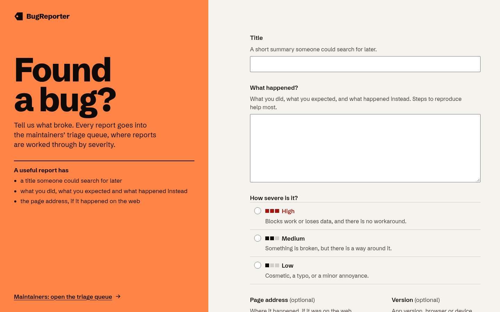
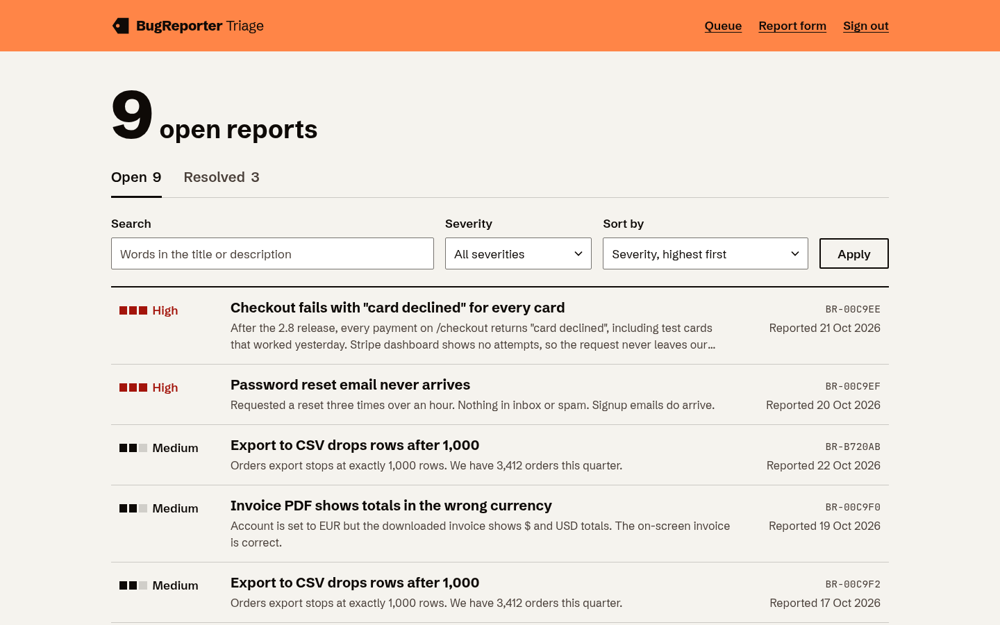
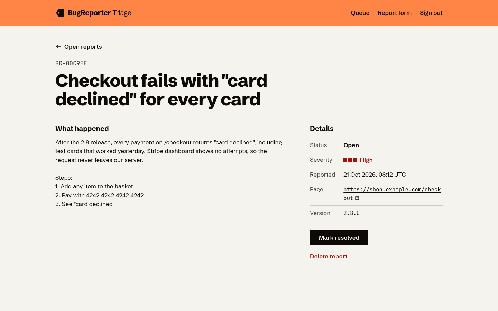
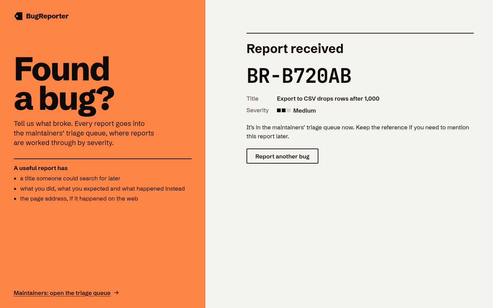
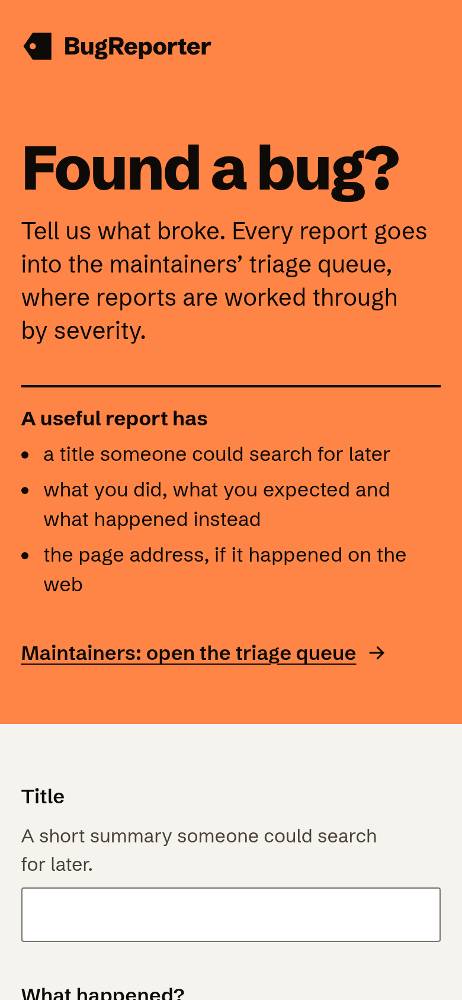
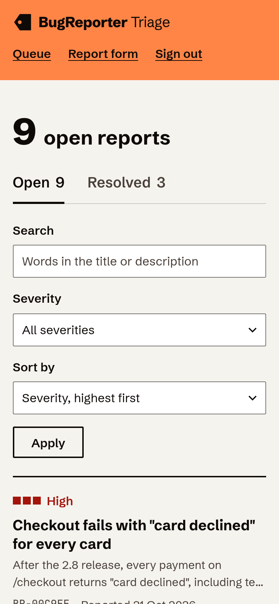
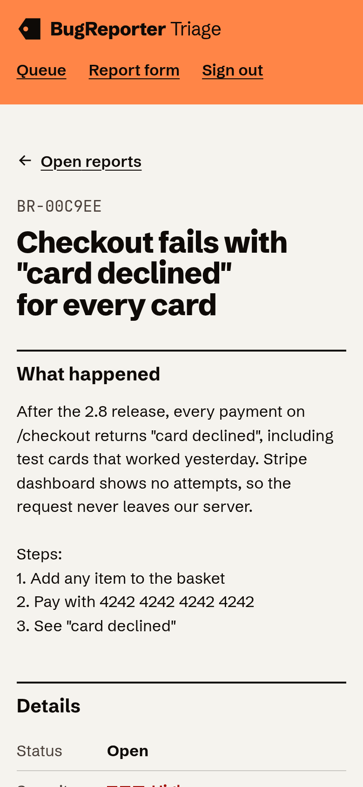

<div align="center">


# BugReporter

**Report a bug in a few fields. Triage it by severity.**

A public bug report form and a maintainer queue, built on Next.js 16 and MongoDB.<br />
Designed as a printed defect tag: one signal-orange field, black ink, and a three-cell severity scale.


[Getting started](#getting-started) · [How it works](#how-it-works) · [Design](DESIGN.md) · [Architecture](docs/architecture.md)



</div>

## The idea

Most bug trackers are built for the people fixing bugs. BugReporter starts with the person who just hit one: a single page that asks for a title, what happened, how bad it is and, optionally, where. It gives back a reference straight away. Maintainers get a queue sorted by severity, with search, filters, and one-click resolve and reopen.

Severity is the one thing that matters in triage, so it has one consistent drawing everywhere: three cells filled from the left (high ■■■, medium ■■□, low ■□□) next to the word. It reads without colour, and the reporter sees exactly what each level means before choosing.


## Screenshots

<table>
  <tr>
    <td><br /><sub>The queue: open reports by severity, with search and filters</sub></td>
    <td><br /><sub>A report: description, details, resolve and delete</sub></td>
  </tr>
  <tr>
    <td><br /><sub>After sending: the reference to keep</sub></td>
    <td><br /><sub>The report form</sub></td>
  </tr>
</table>

<table>
  <tr>
    <td width="33%"></td>
    <td width="33%"></td>
    <td width="33%"></td>
  </tr>
</table>

<sub>Captured 22 October 2026 from a production build, using demo reports for a fictional shop.</sub>

## Features

**Reporting**

- Title, description and severity, plus an optional page address and version.
- Each severity level is explained in plain words on the form itself.
- Errors are listed in a focused summary and next to each field; nothing typed is lost on a failed send.
- A reference (`BR-3F9A1C`) on success, and a clean form for the next report.

**Triage**

- Open and Resolved tabs with live counts.
- Search across titles and descriptions; filter by severity; sort by severity, age or resolution date. Filters live in the URL, so a view can be bookmarked.
- Mark resolved, reopen, or delete after a confirmation dialog.
- Signed in with a shared maintainer password; sessions are signed cookies.

**Operations**

- Reads the original app's MongoDB data as is: same collection, same fields.
- Missing configuration and database outages produce clear messages, not blank pages.
- Builds with no secrets; designed for Vercel's serverless runtime.

## Getting started

Prerequisites: Node.js 20.9+ and Docker (or any MongoDB URI).

```bash
npm install
cp .env.example .env.local
npm run db:up
npm run dev
```

```dotenv
MONGODB_URI=mongodb://localhost:27017
MONGODB_DB=bug-reporter
ADMIN_PASSWORD=choose-a-long-password
SESSION_SECRET=output-of-openssl-rand-base64-32
```

Open http://localhost:3000 to report and http://localhost:3000/triage to triage.

> [!NOTE]
> Triage uses one shared password, and nothing rate-limits sign-in or submissions. That suits a small team; see [Limitations](docs/architecture.md#limitations) before exposing it widely.

<details>
<summary>Scripts</summary>

| Command           | What it does                            |
| ----------------- | --------------------------------------- |
| `npm run dev`     | Development server                      |
| `npm run check`   | Format check, lint, typecheck and tests |
| `npm run build`   | Production build                        |
| `npm run db:up`   | Start MongoDB 8 in Docker               |
| `npm run db:down` | Remove the MongoDB container            |

</details>

<details>
<summary>Deploying to Vercel</summary>

Import the repository, keep the detected Next.js settings, and set `MONGODB_URI`, `ADMIN_PASSWORD` and `SESSION_SECRET` (plus `MONGODB_DB` if needed) for Production and Preview. MongoDB Atlas must allow connections from Vercel. Full steps are in [docs/development.md](docs/development.md#deploying-to-vercel).

</details>

## How it works

| Route          | Who         | What                                                       |
| -------------- | ----------- | ---------------------------------------------------------- |
| `/`            | Anyone      | Report form (static page; submits through a server action) |
| `/sign-in`     | Maintainers | Password sign-in                                           |
| `/triage`      | Maintainers | Queue with tabs, search, severity filter and sort          |
| `/triage/[id]` | Maintainers | One report: resolve, reopen, delete                        |

```
src/
  app/                    routes, layouts, error and not-found boundaries
  features/reports/       model, validation, queue params, repository, server actions, UI
  features/auth/          sign-in form and actions
  lib/                    env, MongoDB client, session tokens
  components/             shared UI (split page, wordmark, icons)
```

Architecture, data model and trade-offs: [docs/architecture.md](docs/architecture.md).

## Design

- **World:** a factory defect tag. A signal-orange field carries the identity; work happens on off-white paper in black ink.
- **Type:** Schibsted Grotesk for everything, JetBrains Mono only for references, URLs and versions. Nothing below 15px.
- **Signature:** the three-cell severity scale, identical on the form, in the queue and on the report.
- **Contrast:** primary ink ≥8:1 and secondary ink ≥7:1, verified numerically. See [DESIGN.md](DESIGN.md) and [`tokens.css`](src/app/tokens.css).

## Testing

```bash
npm test
```

Covers validation, queue URL parsing, session tokens and redirects, the repository against a real `mongod` (including legacy documents), authorization of the triage actions, and the report form's error and confirmation states.

## Acknowledgements

- [Schibsted Grotesk](https://github.com/schibsted/schibsted-grotesk) and [JetBrains Mono](https://www.jetbrains.com/lp/mono/), both under the SIL Open Font License, via Fontsource.
